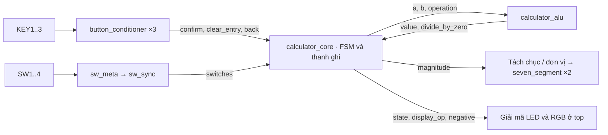
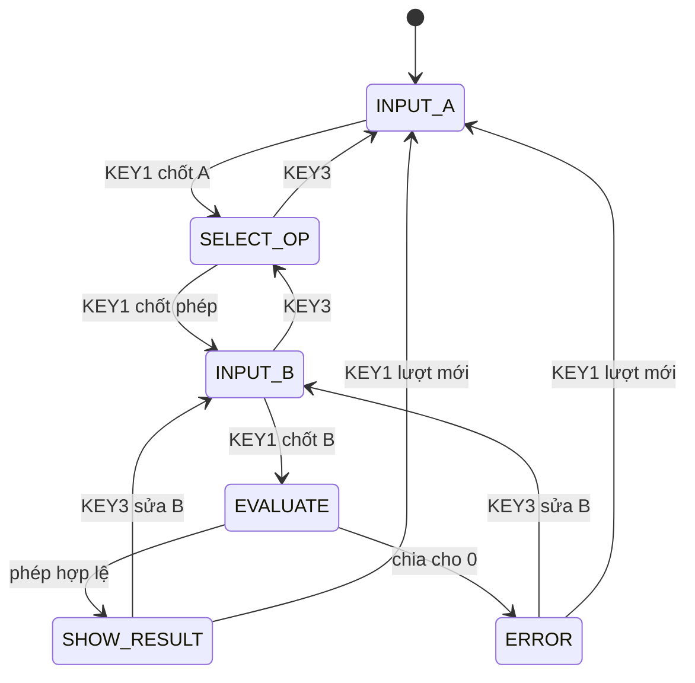

# Calculator số nguyên có dấu · STEP-MAX10

Nhập hai số từ −7 đến +7, chọn cộng, trừ, nhân hoặc chia rồi đọc kết quả trên hai LED 7 đoạn. FSM chốt lần lượt **A → phép tính → B**. ALU tính bằng số có dấu. Chia nguyên bỏ phần lẻ về phía 0 (`−7 / 2 = −3`); chia cho 0 hiện **E1**.

## Mở và nạp board

Để tự gán chân trong Pin Planner, xem [bảng Node Name và Location của calculator](docs/PINOUT.md).

1. Mở [calculator.qpf](quartus/calculator.qpf) trong Quartus Prime Lite 20.1. Top là `calculator_top`, device là `10M02SCM153I7G` giống cấu hình máy bán nước trong repo.
2. Chọn **Processing → Start Compilation**. Trong **Tools → Programmer**, chọn cáp của board, thêm [calculator.sof](quartus/output_files/calculator.sof), đánh dấu **Program/Configure**, rồi **Start**. File SOF được tạo khi biên dịch và không lưu trong Git.
3. Đặt bốn switch về 0, nhấn rồi thả **KEY4**. Dấu hiệu chờ nhập A là **LED5 sáng, màn hình 00, RGB1 xanh dương**. Khi đổi switch, màn hình xem trước số đang nhập.
4. Tất cả file cần để biên dịch nằm ngay trong thư mục calculator, kể cả các module xử lý nút, LED 7 đoạn, file `quartus/calculator.sdc` và bảng gán chân.

Biên dịch từ PowerShell ở thư mục calculator nếu đã cài Quartus theo đường dẫn mặc định:

```powershell
Push-Location quartus
& 'C:/intelFPGA_lite/20.1/quartus/bin64/quartus_sh.exe' --flow compile calculator
Pop-Location
```

## Điều khiển

| Ngoại vi | Cách dùng |
|---|---|
| SW4, SW3..SW1 | Khi nhập A hoặc B, SW4 là bit dấu (1 = âm); SW3..SW1 là độ lớn nhị phân 0–7. Ví dụ `1011` là −3. `1000` và `0000` đều là 0. |
| SW2..SW1 | Khi chọn phép: `00` cộng, `01` trừ, `10` nhân, `11` chia. SW4 và SW3 được bỏ qua ở bước này. Màn hình hiện mã 00–03. |
| KEY1 | Chốt A, phép tính, B. Tại kết quả hoặc lỗi, nhấn để về bước nhập A; lần nhấn kế tiếp mới chốt A. |
| KEY2 | Xóa toàn bộ phép tính và về nhập A. Màn hình lúc này xem trước switch hiện tại. |
| KEY3 | Quay lại một bước: B → chọn phép → nhập A. Từ kết quả hoặc lỗi, trở về nhập B, giữ A và phép toán để thử lại. |
| KEY4 | Reset toàn bộ. Nên nhấn một lần sau khi nạp. |

Gạt switch đến giá trị mong muốn, rồi nhấn và thả KEY1. Ba nút thao tác có chống dội 20 ms; giữ nút chỉ tạo một lần nhấn. Nếu các xung thao tác đến cùng chu kỳ, ưu tiên **xóa > quay lại > chốt**. Ở bước EVALUATE, việc tính hoàn tất trong một chu kỳ, KEY2 vẫn có thể xóa.

| Đầu ra | Ý nghĩa |
|---|---|
| LED1..4 | Lần lượt là cộng, trừ, nhân, chia. Khi chọn phép, LED theo switch; từ bước B trở đi LED theo phép đã chốt. Khi nhập A cả bốn tắt. |
| LED5 / LED6 / LED7 | Đang nhập A / chọn phép / nhập B. |
| LED8 | Số đang hiển thị là số âm. Ví dụ LED8 sáng và màn hình 02 nghĩa là −2. |
| RGB1 | Xanh dương khi nhập hoặc tính, xanh lá khi có kết quả, đỏ khi lỗi. |
| RGB2 | Khi hiển thị số: âm đỏ, dương xanh lá, 0 xanh dương. Tắt khi chọn phép, đánh giá hoặc báo lỗi. |
| Hai LED 7 đoạn | Hiện độ lớn, mã phép hoặc E1. Hai cụm có bus riêng và cùng bật liên tục. |

## Hai bài demo

**1 · Phép trừ cho kết quả âm.** Nhấn KEY4. Đặt lần lượt `0011` (A = 3), `0001` (trừ), `0101` (B = 5); nhấn rồi thả KEY1 sau **mỗi** lần đặt switch. Kết quả: **02**, LED8 sáng, RGB1 xanh lá. Đổi switch khi đang xem kết quả: màn hình vẫn giữ −2.

**2 · Chia cho 0 và sửa lỗi.** Nhấn KEY2. Nhập `1110` (A = −6), `0011` (chia), `0000` (B = 0); mỗi bước chốt bằng KEY1. Màn hình hiện **E1**, RGB1 đỏ. Nhấn KEY3, nhập `1011` (B = −3), chốt bằng KEY1. Kết quả **02**, LED8 tắt. A và phép chia được giữ trong suốt lần sửa.

## Sơ đồ khối và FSM





Reset hoặc KEY2 đưa mọi trạng thái về INPUT_A; trạng thái nhập và trạng thái kết quả giữ nguyên khi không có lệnh. Lúc KEY1 chốt B, FF `b` và `state` cập nhật cùng cạnh. Trong EVALUATE, ALU thấy **B mới**. Tại cạnh kế tiếp, FSM chốt `result` nếu phép hợp lệ, hoặc chuyển ERROR nếu chia cho 0.

| Module | Phần tuần tự | Phần tổ hợp / vai trò |
|---|---|---|
| [calculator_top](rtl/calculator_top.sv) | reset_pipe, hai tầng đồng bộ switch | Tách chữ số, hiển thị E1, giải mã màu, đổi cực tính LED. Chân nút, LED và RGB active-low; segment active-high; common active-low. |
| [calculator_core](rtl/calculator_core.sv) | state, a, b, operation, result | Đổi dấu/độ lớn của switch sang số bù hai, chọn next_state và dữ liệu hiển thị. |
| [calculator_alu](rtl/calculator_alu.sv) | — | case chọn +, −, ×, ÷; kiểm tra B=0 trước phép chia. |
| [button_conditioner](rtl/button_conditioner.sv) ×3 | Đồng bộ hai tầng, đếm mẫu ổn định, phát xung | Một lần nhấn → một sự kiện. |
| [seven_segment](rtl/seven_segment.sv) ×2 | — | case giải mã digit sang các segment a..g. |

**Tại sao dùng 7 bit cho kết quả?** Hai toán hạng có dấu 4 bit, giao diện giới hạn ở −7..+7. Tích lớn nhất theo độ lớn là 49. Số có dấu 6 bit chỉ biểu diễn −32..31; số có dấu 7 bit bao phủ −64..63. Bởi vậy phép tính hợp lệ không thể tràn. `magnitude` dùng 6 bit không dấu để hiển thị 0..49.

**Tại sao có cả thanh ghi và mạch tổ hợp?** ALU tính ngay khi đầu vào đổi. Thanh ghi chốt A, B, phép và kết quả theo cạnh lên của clock. Vì thế khi đã chốt phép trừ, gạt switch để nhập B sẽ không đổi phép toán. Tên state và mã phép được định nghĩa trong [calc_types.sv](rtl/calc_types.sv).

## Mô phỏng và kiểm chứng

Từ thư mục calculator, chạy:

```powershell
./sim/run_tests.ps1
# Nếu vsim chưa nằm trong PATH:
./sim/run_tests.ps1 -ModelSim 'C:/intelFPGA_lite/20.1/modelsim_ase/win32aloem/vsim.exe'
```

Có thể dùng ModelSim Transcript với `source {C:/duong-dan-repo/calculator/sim/run.do}`. Sau khi chạy, để xem lại sóng của bài demo trên board:

```tcl
vsim -voptargs=+acc -onfinish stop work.tb_calculator_top
add wave sim:/tb_calculator_top/clk_12mhz sim:/tb_calculator_top/sw sim:/tb_calculator_top/key sim:/tb_calculator_top/led sim:/tb_calculator_top/rgb1 sim:/tb_calculator_top/rgb2
add wave sim:/tb_calculator_top/dut/core/state
add wave -radix decimal sim:/tb_calculator_top/dut/core/a sim:/tb_calculator_top/dut/core/b sim:/tb_calculator_top/dut/core/result
run -all
wave zoom full
```

| Kiểm tra | Kết quả trên workspace |
|---|---|
| ModelSim 2020.1 · [test core](tb/tb_calculator_core.sv) | PASS. 15 giá trị A × 15 giá trị B × 4 phép = **900 giao dịch** qua FSM, gồm 15 trường hợp chia cho 0. Kiểm tra thêm âm 0, nút quay lại và thứ tự ưu tiên. |
| ModelSim 2020.1 · [test board](tb/tb_calculator_top.sv) | PASS. Kiểm tra dội nút, giữ nút, cực tính, dấu âm, E1, sửa B, kết quả 49, reset và giữ kết quả khi đổi switch. |
| Quartus 20.1 Lite · full compile | Thành công, **0 lỗi, 92 cảnh báo**, đã sinh calculator.sof cho 10M02SCM153I7G. Dùng 336/2304 logic elements và 96 thanh ghi. |
| Chân và timing | 41/41 chân trong báo cáo Fitter khớp [bảng chân của calculator](quartus/step_max10_pins.qsf). Clock 12 MHz, slack setup thấp nhất +70.208 ns, hold +0.146 ns. |

Quartus báo cảnh báo license các tính năng tùy chọn, các chân DP/common cố định, drive strength và cảnh báo 16562 về công suất. Power Analyzer ước tính 115,69 mW, chưa dùng mô hình nhiệt của board. Các kết quả trên là mô phỏng và biên dịch; cần nạp và chạy hai bài demo để xác nhận trên phần cứng thực.
