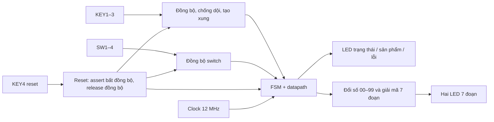
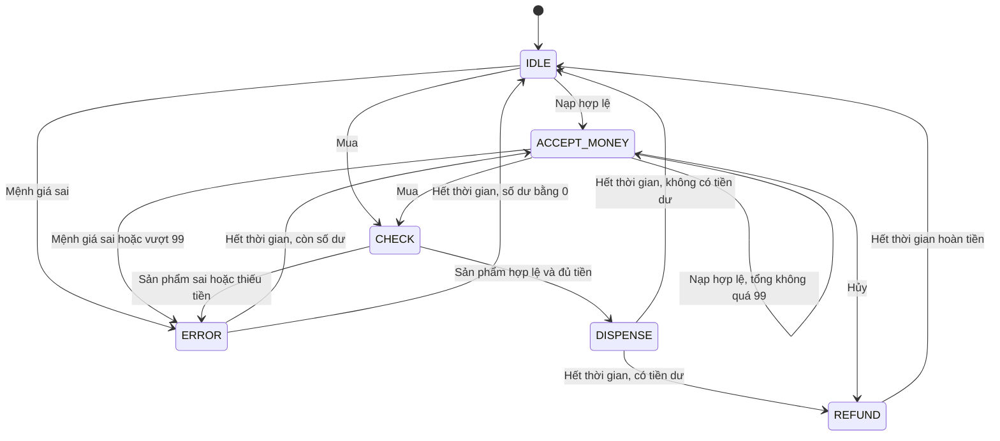

# Thiết kế máy bán hàng

## Liên hệ yêu cầu môn học

| Yêu cầu | Thành phần thực hiện |
|---|---|
| Có FSM | `vending_core`: 6 trạng thái điều khiển giao dịch |
| Mạch tổ hợp | Tra giá, giải mã mệnh giá, cộng số dư, so sánh, trừ tiền dư, giải mã LED 7 đoạn |
| Mạch tuần tự | Thanh ghi trạng thái, số dư, sản phẩm, tiền hoàn và bộ đếm thời gian |
| Ngoại vi | Switch, nút nhấn, LED thường, RGB LED và hai LED 7 đoạn |
| Mô phỏng | Testbench SystemVerilog tự kiểm tra và script ModelSim |

## Sơ đồ khối

Tất cả thanh ghi chức năng dùng cùng clock 12 MHz. Thời gian chờ được đo bằng
counter và điều kiện enable; không tạo clock chậm bằng logic để clock FSM.

## Sơ đồ trạng thái

Reset từ bất kỳ trạng thái nào đưa về `IDLE` và xóa toàn bộ dữ liệu giao dịch.
Trong `IDLE`, hủy không làm gì vì số dư bằng 0. Không có sự kiện thì giữ trạng thái,
trừ `CHECK` tự hoàn tất trong một chu kỳ và các trạng thái có timeout.

| Mã debug | Trạng thái | Hành vi |
|---|---|---|
| 0 | `IDLE` | Số dư 0, nhận thao tác |
| 1 | `ACCEPT_MONEY` | Giữ số dư, nhận thao tác |
| 2 | `CHECK` | Kiểm tra sản phẩm đã chốt và số dư |
| 3 | `DISPENSE` | Một LED sản phẩm sáng, màn hình hiển thị giá |
| 4 | `REFUND` | Hiển thị số tiền hoàn |
| 5 | `ERROR` | Giữ số dư, hiển thị mã lỗi trên LED1–3 |

## Quy tắc giao dịch

- Xung mua chốt sản phẩm vào `selected_product`. Thay đổi switch sau đó không đổi đơn hàng.
- Nạp tiền dùng tổng 8 bit để phát hiện vượt 99 trước khi ghi thanh ghi số dư 7 bit.
- Mua hợp lệ tính `refund_amount = credit - price` rồi xóa `credit`. Phép trừ chỉ xảy ra
  sau khi đã kiểm tra đủ tiền, tránh trừ âm/underflow.
- Hủy chuyển toàn bộ `credit` sang `refund_amount`, rồi xóa `credit`.
- Sai sản phẩm, thiếu tiền hoặc mệnh giá sai không làm mất số dư.
- Một lần giữ nút tạo đúng một xung. Nút phải ổn định ở trạng thái nhả mới được tái kích hoạt.
- Các nút chỉ được xử lý trong `IDLE`/`ACCEPT_MONEY`. Xung phát sinh khi bận không được xếp hàng.
- Khi nhiều xung cùng chu kỳ: hủy ưu tiên mua, mua ưu tiên nạp.
- Counter bắt đầu ở 0 khi vào pha có thời gian; rời pha khi đếm đến `HOLD_CYCLES - 1`.
  Với clock 12 MHz và 24.000.000 chu kỳ, mỗi pha kéo dài 2 giây.

## Tổ chức SystemVerilog

`always_comb` mô tả logic trạng thái kế tiếp và logic tổ hợp, dùng blocking assignment `=`.
Các đầu ra đều có giá trị mặc định hoặc đầy đủ nhánh để tránh suy ra latch.
`always_ff @(posedge clk)` mô tả thanh ghi với non-blocking assignment `<=`.

FSM điều khiển pha nhả hàng/hoàn tiền/báo lỗi theo trạng thái đã đăng ký. Đầu ra cũng
đọc các thanh ghi dữ liệu như sản phẩm, số dư và mã lỗi; đây là bộ điều khiển FSM kết hợp
datapath, không cần tạo một trạng thái cho từng giá trị tiền.

Hai flip-flop đầu vào giúp giảm nguy cơ metastability. Debounce là một chức năng khác:
nó yêu cầu mức nút giữ ổn định đủ lâu để loại dội cơ khí. Các switch được đồng bộ từng bit;
người dùng cần đặt chúng ổn định trước khi nhấn xác nhận, vì đây không phải giao thức
truyền dữ liệu nhiều bit có handshake.

## Nội dung nên giải thích khi vấn đáp

1. Tại sao dùng FSM kết hợp thanh ghi số dư thay vì tạo 100 trạng thái ứng với 00–99?
2. Khác nhau giữa mạch tổ hợp và mạch tuần tự trong từng module?
3. Vì sao xử lý nút cần cả đồng bộ, chống dội và phát hiện lần nhấn?
4. Vì sao số dư 7 bit nhưng tổng cộng tiền là 8 bit?
5. Làm sao bảo đảm nhả đúng sản phẩm nếu người dùng đổi switch giữa giao dịch?
6. Khi bấm mua/nạp/hủy cùng lúc, thiết kế giải quyết thế nào?
7. Counter tạo thời gian 2 giây như thế nào và testbench rút ngắn thời gian ra sao?
8. Những tình huống kiểm thử nào chứng minh không mất tiền hoặc tràn số?
9. Reset khác hủy giao dịch ở đâu? Reset xóa dữ liệu; hủy đi qua pha hoàn tiền.
10. Giới hạn của mô hình: LED chỉ mô phỏng cơ cấu thật, chưa có tồn kho hay lưu trữ bền vững.
