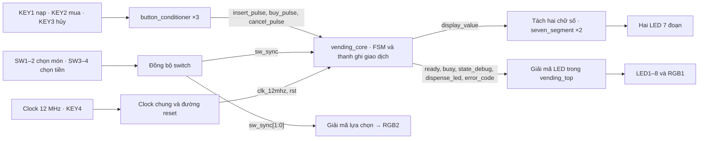
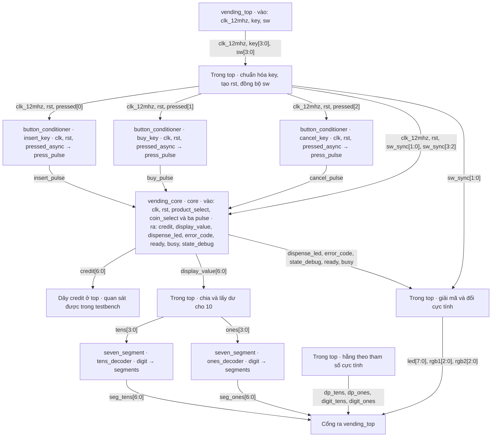
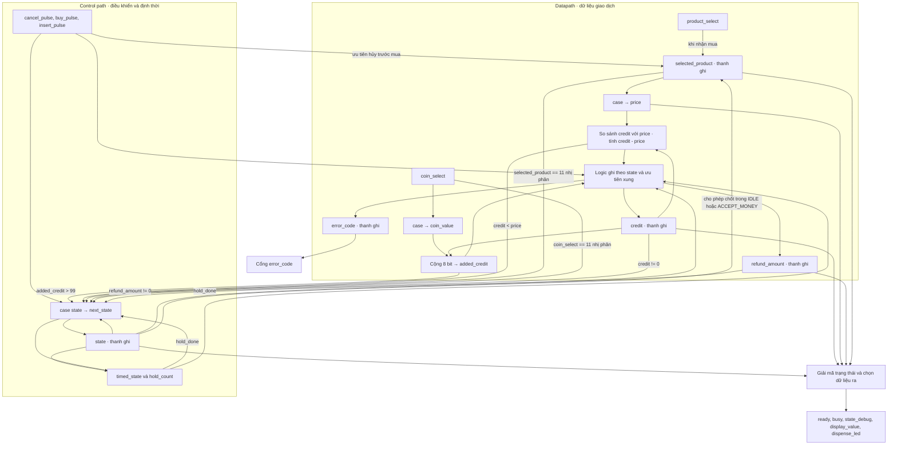
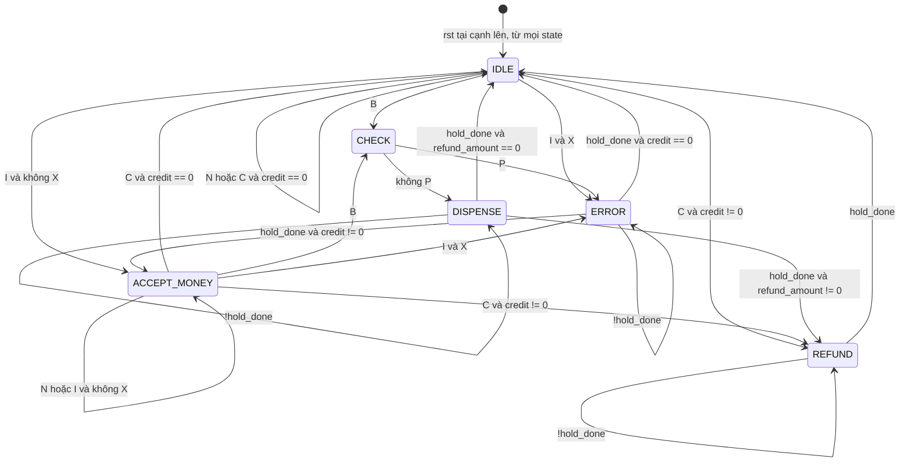
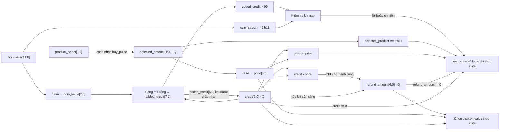
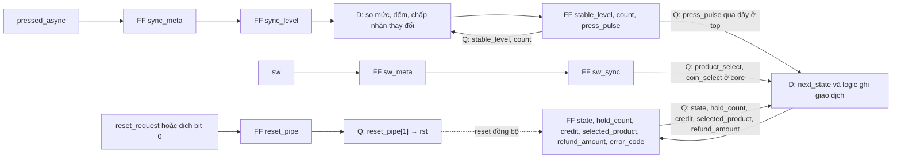
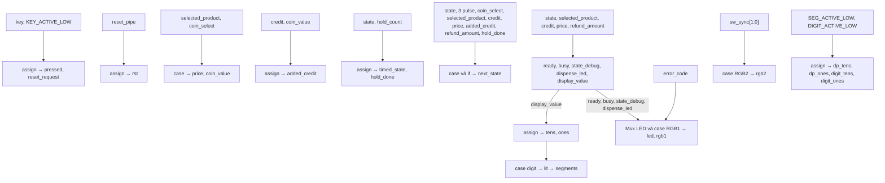
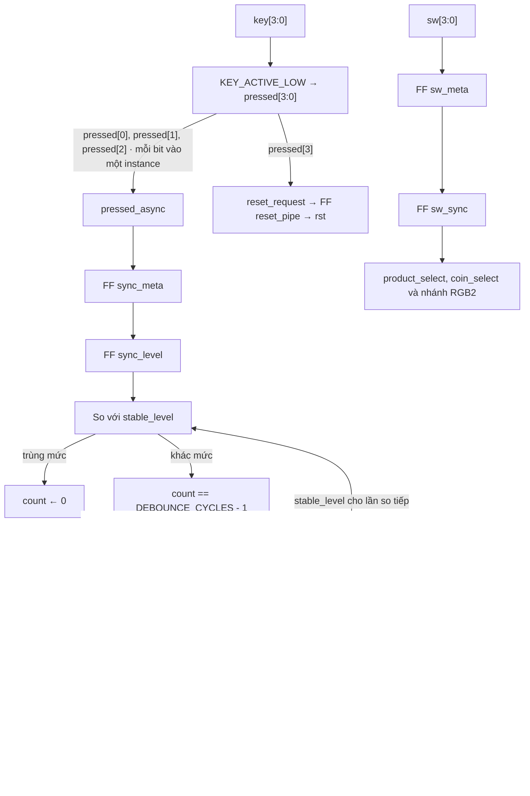
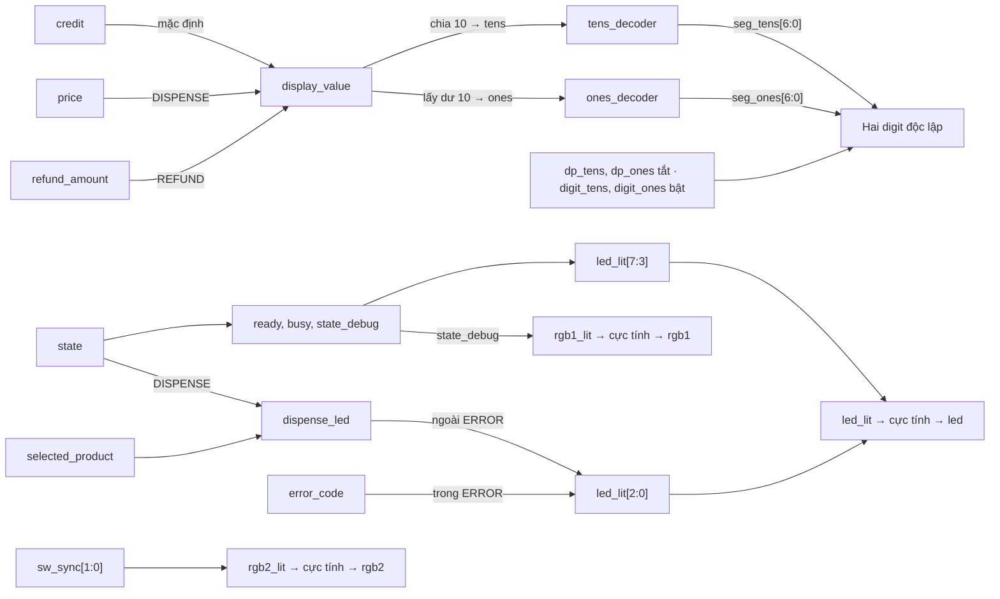

# Máy bán hàng FPGA · Chín sơ đồ đọc cùng mã SystemVerilog

**Cách đọc.** Bắt đầu ở hình 2 để tìm dây thực tế, sang hình 4 để biết khi nào máy đổi trạng thái, rồi dùng hình 5 và 6 để biết tiền đi đâu tại chính cạnh clock đó. Mở bản xem trước Markdown hỗ trợ Mermaid để xem hình. Trong sơ đồ, tên tiếng Việt chỉ chức năng; tên tiếng Anh dạng `snake_case` trùng với RTL. Các hộp bên trong một module mô tả logic, không ngụ ý có thêm module SystemVerilog.

**Cơ sở đối chiếu.** QSF chọn `vending_top`, part `10M02SCM153I7G` và bốn file RTL. SDC khai báo `clk_12mhz` có chu kỳ 83,333 ns (83.333 ns trong file). Các tham số thời gian dưới đây là mặc định ở top. Ba testbench dùng tham số ngắn để kiểm tra hành vi. Mô tả đèn là kết quả RTL theo gán chân hiện tại; từ source không xác định được file cấu hình nào đang chạy trên chiếc board trong ảnh.

## 1. System Overview · Từ thao tác đến đèn



Khi nhấn KEY1, nút tạo đúng một xung sau khi ổn định. Core dùng mệnh giá tại thời điểm nhận xung để cộng tiền. Khi cạnh clock ghi số dư mới, giá trị hiển thị ở trạng thái chờ thay đổi theo. Ngoại vi thể hiện việc nhả hàng và hoàn tiền là đèn trên board; top không khai báo cổng điều khiển động cơ, bộ nhả xu hay OLED.

## 2. Module Architecture · Các instance và dây nối



Có **6 instance con trực tiếp** dưới top. Cả ba conditioner và core dùng cùng `clk_12mhz` qua cổng con `clk`; hai decoder không có clock. `sw_sync[1:0]` vào cổng `product_select`, `sw_sync[3:2]` vào `coin_select`. Dây `credit` được nối ra khỏi core để quan sát; bộ tách chữ số ở top thực sự nhận `display_value`. Đối chiếu [các phép nối cổng trong vending_top.sv](../rtl/vending_top.sv#L53-L76).

## 3. Internal Architecture · Bên trong vending_core



`next_state` quyết định giá trị D của thanh ghi trạng thái. Logic ghi tiền dùng **`case (state)` hiện tại** và các xung/điều kiện ngay trước cạnh clock. Vì vậy tại cạnh rời `CHECK` thành công, FSM sang `DISPENSE`, đồng thời `refund_amount` nhận hiệu cũ và `credit` về 0. Sau cạnh, bộ chọn hiển thị lấy `price`, nên màn hình vẫn hiện giá món dù số dư đã bằng 0. Hai phép toán so sánh và trừ chung một hộp trong hình để thấy chúng dùng cùng toán hạng; RTL không mô tả một ALU dùng chung. [Logic core](../rtl/vending_core.sv#L36-L156)

## 4. FSM · Trạng thái, điều kiện và đầu ra

Các nhãn **C, B, I, N, X, P** dưới đây là ký hiệu rút gọn của hình và bảng, không phải dây RTL. Chúng giữ nguyên thứ tự ưu tiên của `if/else if`.

| Ký hiệu | Biểu thức đầy đủ |
|---|---|
| C | `cancel_pulse` |
| B | `!cancel_pulse && buy_pulse` |
| I | `!cancel_pulse && !buy_pulse && insert_pulse` |
| N | `!cancel_pulse && !buy_pulse && !insert_pulse` |
| X | `coin_select == 2'b11 \|\| added_credit > 8'd99` |
| P | `selected_product == 2'b11 \|\| credit < price` |



| State hiện tại (mã) | Công việc và đầu ra khi đang ở state | Điều kiện → state kế tiếp, nếu `rst=0` |
|---|---|---|
| IDLE (0) | Chờ, `ready=1`, LED4 sáng, RGB1 xanh dương, hiện `credit` | C và có tiền → REFUND; C và hết tiền → IDLE; B → CHECK; I và X → ERROR; I và hợp lệ → ACCEPT_MONEY; N → IDLE |
| ACCEPT_MONEY (1) | Cho phép nạp thêm, mua hoặc hủy. Đèn và hiển thị như IDLE | C và có tiền → REFUND; C và hết tiền → IDLE; B → CHECK; I và X → ERROR; I và hợp lệ hoặc N → ACCEPT_MONEY |
| CHECK (2) | Kiểm tra món đã chốt và số dư trong một chu kỳ. LED8 sáng, RGB1 xanh dương, hiện `credit` | P → ERROR; ngược lại → DISPENSE |
| DISPENSE (3) | LED5, LED8 và một LED món sáng. RGB1 xanh lá, hiện `price` | Chưa `hold_done` → giữ; hết hạn và `refund_amount != 0` → REFUND; hết hạn và bằng 0 → IDLE |
| REFUND (4) | LED6, LED8 sáng. RGB1 xanh lơ, hiện `refund_amount` | Chưa `hold_done` → giữ; hết hạn → IDLE |
| ERROR (5) | LED7, LED8 sáng. RGB1 đỏ, LED3..1 hiện `error_code`; hiển thị số dư được giữ | Chưa `hold_done` → giữ; hết hạn và `credit != 0` → ACCEPT_MONEY; hết hạn và bằng 0 → IDLE |

Ở hai trạng thái sẵn sàng, `busy=0`. Ở bốn trạng thái còn lại, `busy=1`, `ready=0`, các xung thao tác không được xếp hàng. `dispense_led=000` ở mọi state trừ DISPENSE. RGB2 vẫn theo lựa chọn trên switch. Trong bảng, nhánh hủy với số dư 0 được giữ đúng như code dù trong luồng bình thường ACCEPT_MONEY đã có tiền. Nếu mã state ngoài enum, nhánh `default` đưa `next_state` về IDLE. Reset đồng bộ ưu tiên cao hơn mọi chuyển trạng thái.

**Phân loại.** Các đầu ra điều khiển `ready`, `busy`, `state_debug` là **Moore**: chỉ cần biết `state` hiện tại. Đầu ra giao dịch còn phụ thuộc thanh ghi dữ liệu, ví dụ `dispense_led` cần cả `state` và `selected_product`. Nếu coi toàn bộ thanh ghi là trạng thái mở rộng thì các đầu ra core vẫn là kiểu Moore. Các input tức thời tác động lên `next_state` và dữ liệu sẽ ghi ở cạnh tới; đọc input trong logic chuyển trạng thái không đủ để gọi FSM là Mealy. RGB2 nằm ngoài core và giải mã switch đã đồng bộ. [Enum, chuyển trạng thái và giải mã đầu ra](../rtl/vending_core.sv#L20-L156)


## 5. Datapath · Một đồng tiền đi đâu?



| Mã nhị phân | `coin_select → coin_value` | `selected_product → price` |
|---|---|---|
| 00 | 1 | A, giá 5 |
| 01 | 2 | B, giá 10 |
| 10 | 5 | C, giá 15 |
| 11 | Giải mã ra 0; nhánh nạp báo ERR_COIN | Giải mã ra 0; CHECK báo ERR_PRODUCT |

Phép cộng vẫn được tính khi chưa bấm nút. Việc **ghi** số dư mới cần ở IDLE/ACCEPT_MONEY, đến lượt xung nạp, mã xu hợp lệ và tổng ≤99. Vì so sánh tổng **trước** khi lấy bảy bit thấp, nạp 1 vào số dư 99 sẽ báo lỗi và giữ 99. RTL viết:

```systemverilog
    assign added_credit = {1'b0, credit} + {5'b0, coin_value};
```

Ví dụ từ testbench: nạp tổng 12, chọn B giá 10, bấm mua rồi đổi switch sang C. Tại cạnh nhận mua, `selected_product` chốt B. Tại cạnh kết thúc CHECK, hai lệnh dưới cùng đọc giá trị **trước cạnh**, nên ghi tiền hoàn 2 và xóa số dư. Trong DISPENSE màn hình hiện 10 và LED2 sáng; sang REFUND màn hình hiện 02. RGB2 có thể đã chuyển sang màu C. [Logic ghi tiền](../rtl/vending_core.sv#L105-L135) · [Kịch bản testbench](../tb/tb_vending_core.sv)

```systemverilog
                        refund_amount <= credit - price;
                        credit <= 7'd0;
```

## 6. Sequential Logic · Cạnh clock nào ghi thanh ghi nào?



Hình minh họa đường D → FF → Q. `rst` còn đến các FF switch và cả ba conditioner, như bảng dưới. Mọi `<=` lấy vế phải trước cạnh clock. Khi nhánh đang chạy không gán lại một thanh ghi, thanh ghi giữ giá trị cũ.

| Khối `always_ff` (dòng RTL) | Clock và reset | Thanh ghi | Quy tắc cập nhật D |
|---|---|---|---|
| top 37–40 | `posedge clk_12mhz or posedge reset_request` | `reset_pipe[1:0]` | Nhấn reset → 11 ngay; khi thả, mỗi cạnh dịch `{reset_pipe[0],1'b0}`: 11 → 10 → 00. `rst` là bit 1. |
| top 43–51 | `posedge clk_12mhz`; `rst` đồng bộ | `sw_meta[3:0], sw_sync[3:0]` | Reset xóa cả hai. Mỗi cạnh bình thường: `sw_meta ← sw`, `sw_sync ← sw_meta` cũ. |
| conditioner 17–37 (×3) | `posedge clk`; `rst` đồng bộ | `sync_meta, sync_level, stable_level, count, press_pulse` | Reset xóa cả năm. Mỗi cạnh lấy mẫu hai tầng; xóa pulse mặc định. Mức trùng → count=0; mức khác đủ mẫu → count=0, stable_level và pulse nhận sync_level; mức khác chưa đủ → count+1. |
| core 90–138 | `posedge clk`; `rst` đồng bộ | Sáu thanh ghi dưới đây | Reset ưu tiên cao nhất; state, bộ đếm và dữ liệu có thể đổi cùng cạnh. |

| Thanh ghi core | Reset | D ở cạnh lên khi `rst=0` |
|---|---|---|
| `state[2:0]` | IDLE | `next_state` mỗi cạnh. |
| `hold_count` | 0 | Nếu `state != next_state \|\| !timed_state` → 0; nếu vẫn ở state định thời và `!hold_done` → tăng 1; còn lại giữ. |
| `credit[6:0]` | 0 | Ở hai state sẵn sàng: hủy → 0, nạp hợp lệ đến lượt → `added_credit[6:0]`; CHECK thành công → 0; còn lại giữ. |
| `selected_product[1:0]` | 00 | Chỉ chốt `product_select` khi sẵn sàng, có `buy_pulse` và không có `cancel_pulse`. |
| `refund_amount[6:0]` | 0 | Hủy khi sẵn sàng → `credit` cũ; CHECK thành công → `credit-price`; REFUND hết hạn → 0; còn lại giữ. |
| `error_code[2:0]` | ERR_NONE | Khi sẵn sàng mặc định ERR_NONE; nếu xử lý nạp thì mã xu sai → ERR_COIN, quá 99 → ERR_OVERFLOW. CHECK ưu tiên món sai → ERR_PRODUCT rồi mới xét thiếu tiền → ERR_FUNDS. ERROR hết hạn → ERR_NONE. Các nhánh khác giữ. |

`COUNT_WIDTH=max(1,$clog2(DEBOUNCE_CYCLES))` với tham số dương; mặc định 240.000 mẫu cần 18 bit, **mỗi nút có bộ đếm riêng**. `TIMER_WIDTH` tính tương tự cho `HOLD_CYCLES`; 24.000.000 chu kỳ cần 25 bit. Chỉ có **một** `hold_count` dùng chung cho DISPENSE, REFUND và ERROR. Chuyển DISPENSE → REFUND cũng xóa bộ đếm, nên mỗi state có trọn khoảng hai giây riêng. [Counter nút](../rtl/button_conditioner.sv#L10-L35) · [Counter giao dịch](../rtl/vending_core.sv#L89-L105)

## 7. Combinational Logic · Các phép giải mã và chọn dữ liệu



**Kiểm kê theo câu lệnh trong bốn định nghĩa module.** Có 5 khối `always_comb`, 12 câu `assign` và 4 khối `always_ff` trong source. Khi nhân các instance, thiết kế có 6 khối `always_comb` và 6 khối `always_ff` trước tối ưu tổng hợp. Không đếm các `always` sinh clock hoặc kiểm tra trong testbench vào phần cứng.

| Vị trí | Kiểu | Input → phép xử lý → output |
|---|---|---|
| top 33, 34, 41 | 3 assign | `key` và cực tính → `pressed`; `pressed[3]` → `reset_request`; `reset_pipe[1]` → `rst`. |
| core 37–50 | always_comb, 2 case | `selected_product` → `price`; `coin_select` → `coin_value`. Bảng giá và mệnh giá ở hình 5. |
| core 51–53 | 3 assign | Cộng mở rộng → `added_credit`; state thuộc DISPENSE/REFUND/ERROR → `timed_state`; `hold_count == HOLD_CYCLES-1` → `hold_done`. |
| core 56–87 | always_comb, case và if/else | Mặc định `next_state=state`; các điều kiện ghi ở hình 4 chọn đích khác. |
| core 140–156 | always_comb, if/else và case | `state` → `ready, busy, state_debug`; mặc định hiển thị credit, tắt dispense_led. DISPENSE → hiện price và giải mã món; REFUND → hiện refund_amount. |
| top 69–70 | 2 assign | `display_value` chia 10 và lấy dư 10; ép còn 4 bit → `tens, ones`. |
| top 73–76 | 4 assign | Hằng theo hai tham số cực tính → hai DP luôn tắt, hai chân chọn digit luôn bật. |
| seven_segment 8–23 (×2) | always_comb, case và toán tử `?:` | `digit` 0–9 → `lit` theo bảng; default tắt hết; `ACTIVE_LOW` quyết định có đảo bit khi đưa ra `segments`. |
| top 78–101 | always_comb, 2 case và `?:` | Mux lỗi/món và cờ trạng thái → `led_lit`; `state_debug` → `rgb1_lit`; `sw_sync[1:0]` → `rgb2_lit`; đổi cực tính → ba cổng vật lý. |

Ngoài bảng, `if/else` trong **cả bốn** `always_ff` và `case (state)` ở core dòng 105 chọn D cho FF. Chúng có tác dụng ở cạnh clock như hình 6. Không có `always_comb` hoặc `assign` nào trong conditioner. Ví dụ `count + 1` là biểu thức tính D trong khối clocked, còn `added_credit` là dây có phép gán liên tục.


## 8. Input Processing · Nhấn, giữ, thả



- **Đồng bộ.** Nút cơ không có quan hệ pha với clock. Hai FF liên tiếp giảm nguy cơ tín hiệu chưa ổn định lan vào logic. Tại cùng một cạnh, `sync_level` lấy `sync_meta` cũ; bộ đếm lại nhìn `sync_level` cũ.
- **Chống dội.** Chỉ chấp nhận mức mới sau `DEBOUNCE_CYCLES` mẫu liên tiếp khác mức ổn định. Nếu tín hiệu quay về mức cũ trước hạn, bộ đếm về 0. Mặc định là 20 ms ở 12 MHz, ngoài độ trễ đồng bộ.
- **Tạo xung.** Khi chấp nhận chuyển sang nhấn, `sync_level=1` nên `press_pulse=1` một chu kỳ. Khi chấp nhận thả, cả `stable_level` và `press_pulse` nhận 0, chuẩn bị cho lần nhấn kế tiếp. Đây là phát hiện chuyển mức tích hợp trong nhánh debounce; không có FF trễ riêng để so cạnh. Core đọc xung đã đăng ký ở cạnh lên **kế tiếp**.
- **Hai đường riêng.** KEY4 đi qua `reset_pipe`, bỏ qua ba conditioner. Nhấn làm `rst` lên ngay; core và conditioner thực hiện reset tại cạnh clock. Khi thả, `rst` xuống sau hai cạnh; các FF dùng reset đồng bộ bắt đầu chạy bình thường ở cạnh sau đó. Switch qua hai FF mỗi bit, không có bộ chống dội hay cơ chế bảo đảm nhiều bit đổi đồng thời. Core chốt món khi nhận mua và dùng mệnh giá khi nhận nạp.

Hai phép gán dưới nằm trong cùng nhánh xác nhận mức mới. Do `press_pulse` đã được gán mặc định 0 mỗi cạnh, giữ KEY1 liên tục sẽ chỉ nạp một lần. [button_conditioner.sv](../rtl/button_conditioner.sv#L24-L35)

```systemverilog
                stable_level <= sync_level;
                press_pulse <= sync_level;
```

## 9. Output / Display Path · Từ thanh ghi đến chân FPGA



Hai bộ giải mã lái hai bus segment riêng. `display_value=5` cho `tens=0`, `ones=5`, hiện **05**. Thứ tự `segments[6:0]={a,b,c,d,e,f,g}`. Ở top, `SEG_ACTIVE_LOW=0` nên segment mức 1 sáng, DP=0 tắt; `DIGIT_ACTIVE_LOW=1` nên hai common đều ở 0. Decoder đứng riêng mặc định active-low, nhưng cả hai instance được top truyền lại tham số. **Hiển thị tĩnh**: không có clock quét, bộ đếm refresh hoặc luân phiên bật digit. Bộ chọn `display_value` chọn **nội dung**, không chọn digit theo thời gian. [Đường ra của top](../rtl/vending_top.sv#L67-L101)

| Ngoại vi | Nguồn quyết định (1 ở bus `*_lit` nghĩa là sáng) |
|---|---|
| LED1–3 | Ngoài ERROR lấy `dispense_led`: khi nhả A/B/C tương ứng 001/010/100 theo thứ tự {LED3,LED2,LED1}. Trong ERROR lấy `error_code`: 001 món sai, 010 xu sai, 011 thiếu tiền, 100 vượt số dư. |
| LED4 / LED8 | `led_lit[3]=ready`, `led_lit[7]=busy`. Sau reset ở IDLE, `ready=1` → chân `led[3]=0` → LED4 sáng (QSF gán M12). |
| LED5 / LED6 / LED7 | `state_debug` bằng 3/4/5 tương ứng đang nhả/hoàn/báo lỗi. |
| RGB1 | DISPENSE xanh lá, REFUND cyan, ERROR đỏ, mặc định xanh dương (kể cả CHECK). |
| RGB2 | `sw_sync[1:0]` là 00/01/10/11 → đỏ/xanh lá/xanh dương/tắt, kể cả khi core đang bận. |

Mặc định LED đơn và RGB đều active-low, RGB có thứ tự bit {đỏ, lục, lam}. Sau khi reset và switch ổn định ở 00, mẫu dự kiến là **00, LED4 sáng, RGB1 xanh dương, RGB2 đỏ**. Mã lỗi chỉ đọc trên LED3..1 khi LED7 sáng; hai LED RGB là nhóm khác. [Gán chân board](../quartus/step_max10_pins.qsf)

## Bảng module

| Module | Chức năng | Input | Output | Sequential/Combinational |
|---|---|---|---|---|
| vending_top | Top Quartus, xử lý reset/switch, nối sáu instance, hiển thị | clk_12mhz, key[3:0], sw[3:0] | led[7:0], rgb1[2:0], rgb2[2:0], seg_tens[6:0], seg_ones[6:0], dp_tens, dp_ones, digit_tens, digit_ones | Cả hai |
| button_conditioner | Một xung cho một lần nhấn; instance insert_key, buy_key, cancel_key | clk, rst, pressed_async | press_pulse | Tuần tự, có logic tính D |
| vending_core | FSM giao dịch, số dư, tiền hoàn, chọn giá trị hiển thị | clk, rst, product_select[1:0], coin_select[1:0], insert_pulse, buy_pulse, cancel_pulse | credit[6:0], display_value[6:0], dispense_led[2:0], error_code[2:0], ready, busy, state_debug[2:0] | Cả hai |
| seven_segment | Đổi một chữ số sang 7 segment; instance tens_decoder, ones_decoder | digit[3:0] | segments[6:0] | Thuần tổ hợp |
| tb_vending_core | Kiểm giao dịch, ưu tiên, lỗi, ranh giới thời gian; dut là vending_core | Không cổng | Không cổng | Testbench, chỉ mô phỏng |
| tb_vending_top | Kiểm phím, switch, cực tính và hiển thị; dut là vending_top | Không cổng | Không cổng | Testbench, chỉ mô phỏng |
| tb_primitives | Kiểm button_minimum và hai instance low_decoder, high_decoder ở hai cực tính | Không cổng | Không cổng | Testbench, chỉ mô phỏng |

## Bảng signal · Tra theo nguồn và đích

Mỗi hàng gộp các tín hiệu có cùng đoạn đường khi thích hợp. Tên cổng formal trong module con được ghi cạnh tên dây ở top nếu khác nhau.

| Signal | Được tạo ở đâu | Đi đến đâu | Ý nghĩa |
|---|---|---|---|
| clk_12mhz / clk | Chân clock top | Hai always_ff ở top, ba conditioner và core | Một miền clock chung |
| key[3:0] / pressed[3:0] | Chân nút / assign ở top | pressed[0..2] → pressed_async của insert_key, buy_key, cancel_key; pressed[3] → reset_request | Chuẩn hóa 1 = nhấn |
| reset_request / reset_pipe[1:0] / rst | Top, từ pressed[3] / hai FF / bit [1] | reset_pipe → rst → pipeline switch, conditioner, core | Đưa reset vào ngay, nhả đồng bộ |
| sw[3:0] / sw_meta / sw_sync | Chân switch / hai tầng FF top | sw_sync[1:0] → product_select và RGB2; sw_sync[3:2] → coin_select | Chọn món và mệnh giá |
| pressed_async / sync_meta / sync_level | Cổng vào / hai FF mỗi conditioner | Logic so với stable_level | Mức phím đã qua hai tầng |
| stable_level / count | FF mỗi conditioner | Phản hồi về so mức và kiểm ngưỡng | Mức đã chấp nhận / số mẫu khác liên tục |
| press_pulse / insert_pulse, buy_pulse, cancel_pulse | FF ở từng conditioner / dây top | Cổng cùng tên ở core → logic chuyển state và ghi giao dịch | Sự kiện một clock |
| product_select / selected_product | sw_sync[1:0] / FF core | Giải mã price, kiểm mã sai, chọn dispense_led | Món hiện tại trên switch / món đã chốt |
| coin_select / coin_value | sw_sync[3:2] / case core | Kiểm mã xu ở FSM và logic ghi / bộ cộng | Mã xu 2 bit / giá trị 3 bit |
| price[6:0] | case selected_product | So sánh, phép trừ, mux hiển thị | Giá của món **đã chốt** |
| credit[6:0] | FF core, cũng là cổng ra | Bộ cộng, so sánh, trừ, điều kiện hủy/hết lỗi, mux hiển thị; dây credit ở top | Tiền hiện có |
| added_credit[7:0] | Bộ cộng core | So với 99, bảy bit thấp vào D của credit | Tổng dự kiến trước khi cho phép ghi |
| refund_amount[6:0] | FF core | Mux hiển thị và quyết định DISPENSE → REFUND | Toàn bộ tiền khi hủy hoặc phần dư khi mua |
| state / next_state | FF core / logic tổ hợp | state → điều khiển, đầu ra và bộ đếm; next_state → D của state và điều kiện xóa bộ đếm | Trạng thái hiện tại và kế tiếp |
| hold_count / timed_state / hold_done | FF đếm / giải mã state / so ngưỡng | Phản hồi bộ đếm; hold_done → FSM và logic xóa refund_amount, error_code | Đếm thời gian hiện thông báo |
| ready / busy / state_debug[2:0] | Tổ hợp từ state ở core | Top: LED4, LED8 / đèn pha giao dịch, mux lỗi, RGB1 | Sẵn sàng, bận, mã state |
| error_code[2:0] / dispense_led[2:0] | FF lỗi / logic state và món ở core | Top chọn một trong hai cho led_lit[2:0] | Mã lỗi hoặc món đang nhả |
| display_value[6:0] | Mux core | Phép chia và lấy dư ở top | Số cần hiển thị ngay bây giờ |
| tens[3:0], ones[3:0] / digit[3:0] | assign ở top / cổng decoder | tens_decoder, ones_decoder | Chữ số hàng chục và hàng đơn vị |
| lit[6:0] / segments[6:0] | case digit / đổi cực tính trong mỗi decoder | seg_tens[6:0], seg_ones[6:0] trên board | Mẫu a..g |
| dp_tens, dp_ones / digit_tens, digit_ones | assign hằng ở top | Dấu chấm / common của hai digit | Luôn tắt DP, luôn bật common |
| led_lit[7:0] / led[7:0] | Top giải mã / đổi cực tính | Tám LED đơn | Món hoặc lỗi, ready, dispense, refund, error, busy |
| rgb1_lit[2:0] / rgb1[2:0] | case state_debug / đổi cực tính | RGB1 | Màu trạng thái máy |
| rgb2_lit[2:0] / rgb2[2:0] | case sw_sync[1:0] / đổi cực tính | RGB2 | Màu món đang chọn trên switch |

## Tự kiểm tra khi vấn đáp

1. **Cùng bấm mua và nạp thì số dư có tăng trước khi mua không?** Ở state sẵn sàng, nếu không có hủy thì mua thắng. Máy chốt món, chuyển CHECK và bỏ xung nạp. Xem cùng thứ tự ưu tiên ở cả logic `next_state` và logic ghi FF.
2. **Sao hết lỗi máy đôi khi về ACCEPT_MONEY thay vì IDLE?** Vì điều kiện ở cuối ERROR đọc `credit != 0`. Lỗi giữ nguyên số dư, cho phép nạp thêm hoặc chọn lại.
3. **Nhìn LED4 có phân biệt được IDLE và ACCEPT_MONEY không?** Cả hai đều bật LED4. Muốn phân biệt trực tiếp, quan sát `state_debug` trong mô phỏng; muốn biết còn bao nhiêu tiền, đọc hai digit khi máy sẵn sàng.
4. **Tại sao màn hình hiện 02 khi thanh ghi credit bằng 0?** Ở REFUND, nguồn hiển thị là `refund_amount`. Dùng kịch bản mua B với số dư 12 để lần theo cùng số 2 từ phép trừ tới LED 7 đoạn.

**Đối chiếu testbench.** Log ModelSim hiện có trong workspace ghi PASS cho core (56 kiểm tra có đếm), top (14 kiểm tra) và primitives (16 mã digit, hai cực tính và debounce tối thiểu). Đây là log mô phỏng của project; các bảng trên lấy điều kiện trực tiếp từ RTL, bao gồm cả các nhánh không có tình huống kiểm riêng trong ba testbench.
